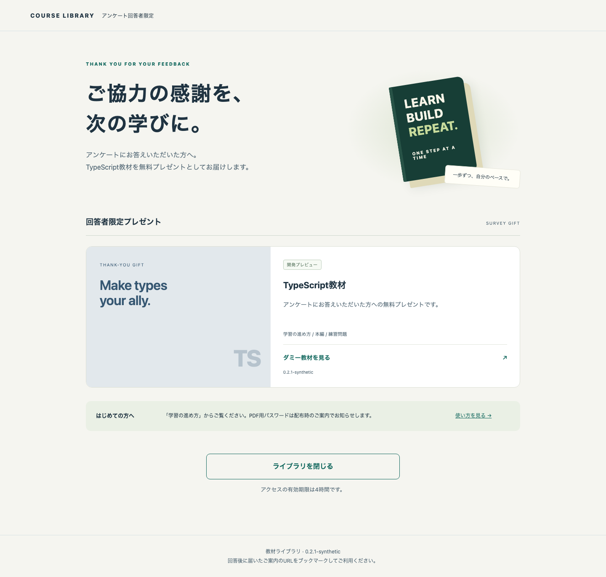
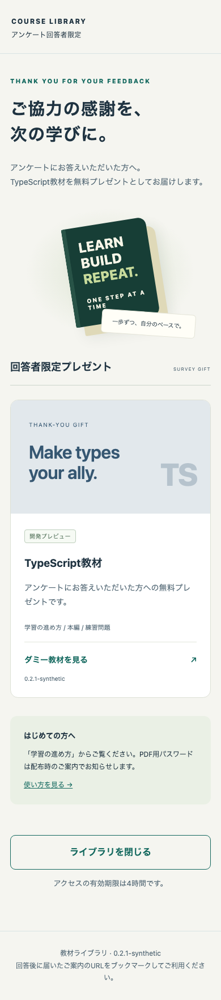

# Course Library

A small Japanese library for the TypeScript survey-response gift built with TypeScript, Cloudflare Workers, and a **private** R2 bucket. A stable entry URL, one shared access phrase, and a clear course catalogue keep delivery simple.

**Status: local prototype, version 0.2.1. No live deployment. Every downloadable file is synthetic.**

## Try locally

Requires Node.js 22.23+ and npm.

```sh
npm ci
npm run hooks:install
npm run check
npm run dev
```

Open `http://127.0.0.1:8797` and enter the **local dummy phrase** `synthetic-development-only`. Local signing keys are generated in memory for each preview. They are never production credentials. The preview binds only to the loopback interface and uses ephemeral local R2 data. The checked-in Wrangler configuration deliberately refuses production requests until secure setup is complete.

**Distribution scope:** TypeScript is the free gift for survey respondents. Taskapp is a paid product and is never included in this gift library. Every Taskapp product URL is denied even with valid gift authentication.

The local TypeScript preview has 20 clearly synthetic PDFs (learning flow, ten chapters, exercises for chapters01–08 and10 (none for09)) and one ZIP. This is a test fixture structure, not confirmation of the actual release inventory. Real files, the approved version and the MyASP survey-response settings remain unverified.

Production shows a preparation state and denies downloads until a non-synthetic published release and both `giftPolicy.myaspVerified` and `giftPolicy.distributionApproved` are reviewed and enabled. Both flags are currently false. `npm run release:ready` intentionally fails in this state, and the optional deploy job runs this gate before deployment.

## Design

Japanese typography, warm paper backgrounds, restrained forest and slate colours, CSS book illustrations, a focused gift card, and a compact mobile layout. Forms have visible labels, focus indicators, a submitting state, and errors. All navigation and downloads work without JavaScript; the small script only gives submission feedback. No external fonts, image services, analytics, or trackers.

## Architecture

```mermaid
flowchart LR
  Reader[Survey respondent] --> Entry[Stable Worker URL]
  Entry --> Phrase[Shared phrase + CSRF check]
  Phrase --> Cookie[Signed 4-hour HttpOnly cookie]
  Cookie --> Catalogue[TypeScript survey gift]
  Catalogue --> Policy[Approved survey-gift release]
  Policy --> Gate[Authenticated GET / HEAD / Range]
  Gate --> R2[Private R2 binding]
  R2 --> Stream[Streamed attachment · no-store]
```



MyASP stays unchanged while its actual survey/invitation settings are being read-only reviewed. The shared phrase does not independently prove survey completion; the respondent-only invitation route must be confirmed before release. No API integration, member accounts, payments, or LMS. The Worker never returns a public R2 URL, exposes a storage listing, or uses shared application caches. File IDs resolve only through an allowlisted manifest. Course object keys include a collection and immutable release version. See [operations](docs/OPERATIONS.md) and [security](docs/SECURITY.md).

For the first release, use the concise [Japanese setup guide](docs/SETUP.md). It separates secret preparation from publishing, including the immediate-deploy side effect of ordinary Wrangler secret commands.

## Verification

Verified locally on macOS with Node 22.23.4: strict type checking, Worker dry-run bundle, and real workerd/Miniflare tests with local R2 and native rate-limit bindings. These tests cover anonymous direct downloads (including HEAD and Range), invalid/expired authentication, cache isolation, filename validation, CSRF, brute-force limits, and byte-for-byte downloads of all 21 TypeScript synthetic files, denial of legacy Taskapp product URLs and product/recipient manifest mixing, and fail-closed production release approval.

Local Chromium visual checks also cover desktop (1440×1000), mobile viewport (390×844), keyboard focus, wrong-phrase errors, submitting feedback, attachment bytes, missing downloads, pending distribution settings, repeated login/logout and anonymous HEAD/Range denial. Screenshots below contain only synthetic materials. These are Chromium viewport checks on a Mac, not physical-device certification.





Windows and WSL are **pending**. Real course code, PDF password compatibility, Safari, physical mobile devices, and production Cloudflare are **not yet verified**.

`npm run check` includes the public staged-file/history scan. The local pre-push hook runs it again before publication; install it with `npm run hooks:install`. Pattern scanning supplements manual review and cannot prove that arbitrary content is safe to publish.

Optional browser reproduction uses an already-installed official Playwright package and Chromium executable:

```sh
COURSE_PLAYWRIGHT_PACKAGE=/path/to/installed/playwright \
COURSE_BROWSER_EXECUTABLE=/path/to/installed/chromium \
npm run test:browser
```

Run `npm run build` first. This opt-in test starts one loopback test runtime, a new temporary BrowserServer, one context and one page, and closes its own handles in `finally`. It never downloads browsers or opens personal browser profiles. Screenshots and downloaded synthetic fixtures stay in ignored `artifacts/visual/`.

## Delivery controls

The workflow is manual-only and has not been executed. It uses standard `ubuntu-latest` GitHub-hosted runners, no caches or uploaded artifacts, and serializes verification and optional deployment at one commit. Optional deployment refuses to run until the target plan/limits and secure configuration are approved. No Cloudflare Git auto-deployment should be enabled alongside it. Costs depend on the actual target account and its limits; no zero-charge claim is made.

This repository contains application code and synthetic fixture generators only. Keep course files, reader data, credentials, and private inventory reports outside Git.

Private release candidates can be checked offline with `npm run candidate:check -- --candidate <ignored-json> --policy <ignored-json> --root <private-directory> --output <ignored-report>`. This requires existing `pdfinfo` and `pdftotext` commands. Source identities, explicit chapter IDs, topic anchors, byte hashes, pages, versions and foreign-course markers are checked; `--mode strict` also rejects missing body version labels. A candidate report never approves a release, changes originals, encrypts files or uploads anything. Real IDs, policy values, PDF text and candidate files belong outside public Git.
