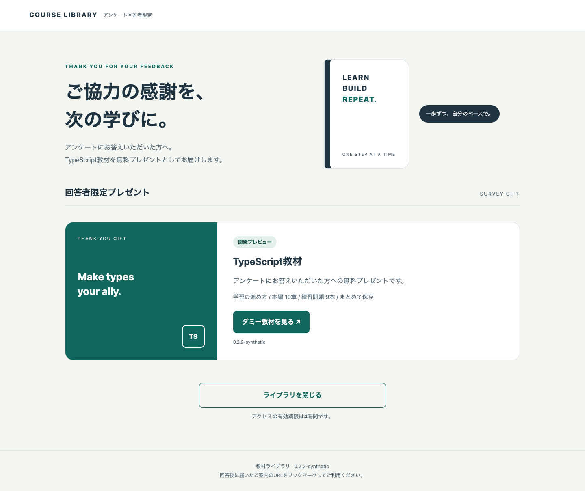
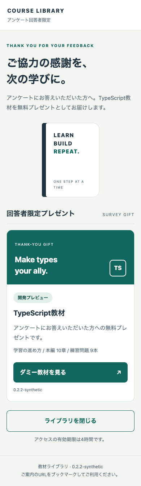

# Course Library

A small Japanese course library built with TypeScript, Cloudflare Workers, and a **private** R2 bucket. It delivers two kinds of material: the free TypeScript gift for survey respondents and paid products for buyers (currently `redmine-clone` and `task-app`). A stable entry URL, a separate access phrase for each collection, and a clear course catalogue keep delivery simple.

**Status: a Worker is live at `https://course-library.kouiso.workers.dev` behind an outer HTTP Basic site gate and the access phrases (an anonymous request answers 401). Which commit is deployed, and whether each product's phrase secret and R2 objects are in place, is recorded privately by the operator and cannot be read from this repository; `package.json` has said 0.2.2 since before `task-app` was added, so the version number alone does not tell. The survey gift stays closed in production until its approval flags and real (non-synthetic) materials land. In this repository's `src/manifest.ts`, the paid products `redmine-clone` and `task-app` are published and approved, each with its own approval flag; production opens a product only to people who enter that product's phrase, which needs the product phrase secret described in the [setup guide](docs/SETUP.md#商品の合言葉任意). Every downloadable file generated in this repository is synthetic; real materials are never committed.**

## Try locally

Requires Node.js 22.23+ (`.nvmrc` pins 22.23.4) and npm. `npm run check` also needs poppler for `pdfinfo` and `pdftotext` (macOS: `brew install poppler`, Ubuntu: `apt install poppler-utils`); without them the candidate tests stop with a message naming the missing tool.

```sh
npm ci
npm run hooks:install
npm run check
npm run dev
```

Open `http://127.0.0.1:8797` and enter one of the three **local dummy phrases** (the preview also prints all three):

- `synthetic-development-only` opens the TypeScript survey gift (synthetic PDFs and ZIP).
- `synthetic-product-development-only` opens the `redmine-clone` product page; its source ZIP is a local dummy that contains only a placeholder text file, and its textbook ZIP holds one synthetic PDF.
- `synthetic-task-app-development-only` opens the `task-app` product page; its source ZIP and textbook ZIP are local dummies of the same kind.

None is a production phrase. Local signing keys are generated in memory for each preview. They are never production credentials. The preview binds only to the loopback interface and uses ephemeral local R2 data.

**Distribution scope:** The library distributes two kinds of material. The free gift for survey respondents is the TypeScript course. Paid products for buyers (currently `redmine-clone` and `task-app`) are separate collections, each with its own phrase, release prefix and approval flag. A paid product is never part of the free gift: a gift phrase never opens a product, a product phrase never opens the gift, and a URL whose collection id is not in the manifest is denied even with valid authentication. The outer HTTP Basic site gate stays in place after distribution starts. How buyers receive their phrase is decided by the operator and is deliberately not written in this public repository.

The local TypeScript preview has 20 clearly synthetic PDFs (learning flow, ten chapters, exercises for chapters01–08 and10 (none for09)) and one ZIP. This is a test fixture structure, not confirmation of the actual release inventory. Real files, the approved version and the MyASP survey-response settings remain unverified.

For the survey gift, production shows a preparation state and denies downloads until a non-synthetic published release and both `giftPolicy.myaspVerified` and `giftPolicy.distributionApproved` are reviewed and enabled. Both flags are currently false. A paid product is distributed in production when its release is non-synthetic, its status is `published` and its own approval flag is true (`productPolicy.distributionApproved` for `redmine-clone` and `taskAppPolicy.distributionApproved` for `task-app`, both currently true); the steps are in [Distribute a paid product](docs/OPERATIONS.md#distribute-a-paid-product). `npm run release:ready` prints one `survey-gift:` and one `paid-product:` line per collection. It fails (exit 1) when no collection, gift or paid product, can be distributed, and the message names which side is blocked. A blocked collection is still reported on its own line; when something else is ready it exits 0 and a Note says the blocked collections stay closed in production. An approved survey gift that cannot be distributed also fails, and so does a manifest that `validateManifest` rejects (it throws before any line is printed). The optional deploy job runs this gate before deployment.

## Design

Japanese typography, warm paper backgrounds, restrained forest and slate colours, CSS book illustrations, a focused gift card, and a compact mobile layout. Forms have visible labels, focus indicators, a submitting state, and errors. An empty material object shows a preparation page (503), and closing the library lands on a fixed `/closed` confirmation page instead of a silent redirect. All navigation and downloads work without JavaScript; the small script only gives submission feedback. No external fonts, image services, analytics, or trackers.

## Architecture

```mermaid
flowchart LR
  Reader[Survey respondent or buyer] --> Entry[Stable Worker URL]
  Entry --> Basic[HTTP Basic site gate - production only]
  Basic --> Phrase[Phrase of one collection + CSRF check]
  Phrase --> Cookie[Signed 4-hour HttpOnly cookie]
  Cookie --> Catalogue[Collection opened by that phrase - gift or paid product]
  Catalogue --> Policy[Approved release of that collection]
  Policy --> Gate[Authenticated GET / HEAD / Range]
  Gate --> R2[Private R2 binding]
  R2 --> Stream[Streamed attachment · no-store]
```



MyASP stays unchanged while its actual survey/invitation settings are being read-only reviewed. The shared phrase does not independently prove survey completion; the respondent-only invitation route must be confirmed before release. No API integration, member accounts, payments, or LMS. The Worker never returns a public R2 URL, exposes a storage listing, or uses shared application caches. File IDs resolve only through an allowlisted manifest. Course object keys include a collection and immutable release version. See [operations](docs/OPERATIONS.md) and [security](docs/SECURITY.md).

For the first release, use the concise [Japanese setup guide](docs/SETUP.md). It separates secret preparation from publishing, including the immediate-deploy side effect of ordinary Wrangler secret commands.

## Verification

Verified locally on macOS with Node 22.23.4: strict type checking, Worker dry-run bundle, and real workerd/Miniflare tests with local R2 and native rate-limit bindings. These tests cover anonymous direct downloads (including HEAD and Range), invalid/expired authentication, cache isolation, filename validation, CSRF, brute-force limits, and byte-for-byte downloads of all 21 TypeScript synthetic files, the product phrase opening only its product and the gift phrase opening only the gift, denial of URLs whose collection id is not in the manifest, product/recipient manifest mixing, and fail-closed production release approval.

Local Chromium visual checks also cover desktop (1440×1000), mobile viewport (390×844), keyboard focus, wrong-phrase errors, submitting feedback, attachment bytes, missing or empty downloads, pending distribution settings, repeated login/logout and anonymous HEAD/Range denial. Screenshots below contain only synthetic materials. These are Chromium viewport checks on a Mac, not physical-device certification.





Windows and WSL are **pending**. Real course code, PDF password compatibility, Safari, and physical mobile devices are **not yet verified**. The production checks recorded here were made on the synthetic build only (login page, phrase authentication, catalogue, status page, and fail-closed download denial); the paid products in production have not been checked from this repository.

`npm run check` includes the public staged-file/history scan. The local pre-push hook runs it again before publication; install it with `npm run hooks:install`. Pattern scanning supplements manual review and cannot prove that arbitrary content is safe to publish.

Optional browser reproduction uses an already-installed official Playwright package and its Chromium. Verified working with Playwright 1.64.1 and its bundled Chromium (revision 1248):

```sh
npm run build
npm run test:browser
```

Without environment variables, the script looks for Playwright (`playwright-core` or `playwright`) in this repository's `node_modules`, the global npm folder and the npx cache (`~/.npm/_npx`), and uses the Chromium that Playwright itself expects (normally under `~/.cache/ms-playwright`). It prints the paths it chose. If none is found, it prints what to install (for example `npm install --no-save playwright@1.64.1 && npx playwright install chromium`) and exits without downloading anything. To choose other tooling, set both paths:

```sh
COURSE_PLAYWRIGHT_PACKAGE=/path/to/installed/playwright \
COURSE_BROWSER_EXECUTABLE=/path/to/installed/chromium \
npm run test:browser
```

On Linux, Chromium also needs its system libraries (for example NSS and NSPR; `npx playwright install-deps chromium` installs them). This opt-in test starts one loopback test runtime, a new temporary BrowserServer, one context and one page, and closes its own handles in `finally`. It never downloads browsers or opens personal browser profiles. Screenshots and downloaded synthetic fixtures stay in ignored `artifacts/visual/`.

When to run it: run `npm run test:browser` whenever a change touches what a visitor sees on screen (the key screen, the library or product pages, buttons, wording, layout, styles), and before publishing such a change. It is not part of `npm run check`, the pre-push hook or CI, so nothing runs it for you. CI deliberately does not run it: no verification run of this repository has happened in GitHub Actions yet (the recorded runs are two Dependabot updates and one failed `push`-event entry for `promote-product.yml` on 2026-11-16), so the Chromium download time and cost are unmeasured, and the check needs a locally installed browser. If you later want it in CI, measure a real run first and then change `.github/workflows/verify.yml`.

Finding the tooling: the script reads two paths from the environment and downloads nothing. `COURSE_PLAYWRIGHT_PACKAGE` is the directory of an installed official `playwright` package (for example a global or other-project `node_modules/playwright`). `COURSE_BROWSER_EXECUTABLE` is the path to an installed Chromium or Chrome binary (for example the one under Playwright's browser cache, or the system Chrome). If you have neither, install them yourself outside this repository first (`npm install playwright` in a scratch directory, then `npx playwright install chromium` there) and point the two variables at the results. Setting both variables always works. If they are not set, the script either finds an already-installed Playwright with its matching Chromium by itself (once automatic discovery from issue #52 is merged) or stops with an error that names them; it never downloads browsers.

## Delivery controls

Every workflow can be started by hand (`workflow_dispatch`). `promote-product.yml` also answers `repository_dispatch` (`product-release`) sent by a product repository; it only opens a pull request that points a product at a new release and never deploys. No workflow has been dispatched yet; repository automation is listed in [operations](docs/OPERATIONS.md#repository-automation-manual). It uses standard `ubuntu-latest` GitHub-hosted runners, no caches or uploaded artifacts, and serializes verification and optional deployment at one commit. Optional deployment refuses to run until the target plan/limits and secure configuration are approved. No Cloudflare Git auto-deployment should be enabled alongside it. Costs depend on the actual target account and its limits; no zero-charge claim is made.

This repository contains application code and synthetic fixture generators only. Keep course files, reader data, credentials, and private inventory reports outside Git.

Private release candidates can be checked offline with `npm run candidate:check -- --candidate <ignored-json> --policy <ignored-json> --root <private-directory> --output <ignored-report>`. This requires existing `pdfinfo` and `pdftotext` commands. Source identities, explicit chapter IDs, topic anchors, byte hashes, pages, versions and foreign-course markers are checked; `--mode strict` is an optional diagnostic that also rejects missing body version labels; printed labels are not a distribution requirement when a source snapshot is traceable by original filenames, acquisition records and SHA-256. Reports use private atomic replacement; keep the output in an ignored directory or outside the repository so temporary files remain private after interruption. A candidate report never approves a release, changes originals, encrypts files or uploads anything. Real IDs, policy values, PDF text and candidate files belong outside public Git.
